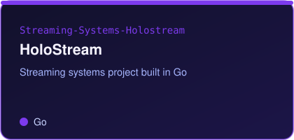

  
  
  
  

> **Cybersecurity engineer at Boston University.**
> Cybersecurity engineer, cloud and DevOps practitioner and full-stack developer with a growing focus on AI security. CEH v12 and AWS Certified Solutions Architect. I like systems-level C, network transport, and tools that explain what they find.

### 📈 Contribution activity

---

### 🧩 Featured projects

<table>
<tr>
<td width="33%"></td>
<td width="33%"></td>
<td width="33%"></td>
</tr>
<tr>
<td width="33%"></td>
<td width="33%"></td>
<td width="33%"></td>
</tr>
</table>

---

### 🛠️ Tech stack

---

### 📊 GitHub stats

Boston, USA · Boston University

