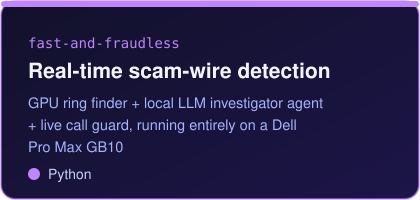
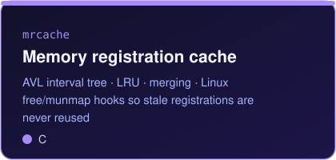
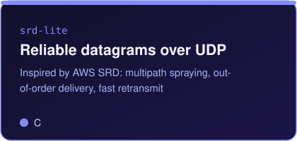
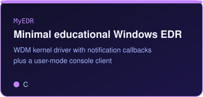
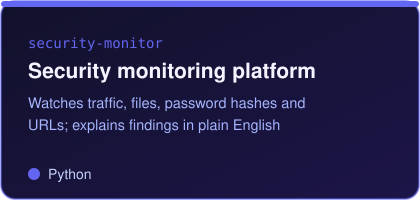
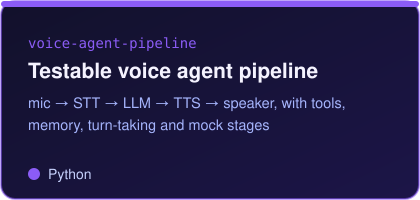

  
  
  
  
  
  
  

> **MS in Computer Science + Cybersecurity at Boston University (graduating Dec 2026).**
> Cybersecurity engineer who ships: cloud and DevOps, full-stack products, and AI systems with security built in. 5x hackathon winner. CEH v12 (125/125), AWS Solutions Architect Associate (914/1000) and AWS Certified Security - Specialty. I like systems-level C, network transport, and tools that explain what they find.

### 📈 Contribution activity

---

### 🧩 What I'm doing now

<table>
<tr>
<td width="33%" valign="top"><b>Product Manager</b> Boston University · BU Spark!  Software Engineering Practicum (DS519), Fall 2026 · present</td>
<td width="33%" valign="top"><b>MS CS + Cybersecurity</b> Boston University · GPA 3.63  Graduating Dec 2026 · security, blockchain, algorithms, mobile forensics</td>
<td width="33%" valign="top"><b>Building in public</b> Systems, security, AI agents  RDMA memory registration cache, multipath UDP transport, Windows EDR, local-GPU fraud detection</td>
</tr>
</table>

### 💼 Experience

| Role | Where | When | What |
|---|---|---|---|
| Teaching Assistant, Software Engineering (CS411S) | Boston University | Summer 2026 | Ran the course's lab sessions, graded labs and assignments, mentored the group project |
| Lead Software / DevOps Intern | STP Web Hosting | 01/2025 - 07/2025 | Led ResumeForge, a React + Django resume builder with a Node/Puppeteer PDF service, plus CI/CD and AWS infrastructure |
| Lead Software Engineering Intern | IIT Bombay (FOSSEE) | 12/2024 - 06/2025 | Python/Click command-line tool for Osdag, a PowerShell installer for environment setup, onboarding guides for new interns |

---

### 🏆 Hackathon wins

| Event | Result | Project |
|---|---|---|
| YHacks 2026 | Winner | [HiveOps](https://github.com/aumghelani/HiveOps-NatomaSub): human-in-the-loop incident response with a multi-agent pipeline |
| Civic Hacks '26 | Winner, 3 categories | [FoodGrid](https://github.com/aumghelani/Foodgrid): food-access equity map for Boston census tracts |
| Red Hat x NVIDIA vLLM Hackathon, Boston | Winner: Track 5 (Agentic Edge) + Upstream | [PRGenie](https://github.com/aumghelani/PRGenie-Nemoclaw): multi-agent GitHub PR triage on vLLM and Nemotron |
| ETHGlobal New York 2026 | Winner: Best Use of Tokenization on Hedera | [CashMeIfYouCan](https://github.com/aumghelani/ETHGlobal-Hackathon-Fiduciary-Agent): AI agents bid on freelancer invoices |
| MedAI Hackathon | Winner | April 2026 |

---

### 🔧 Featured projects

<table>
<tr>
<td width="33%"></td>
<td width="33%"></td>
<td width="33%"></td>
</tr>
<tr>
<td width="33%"></td>
<td width="33%"></td>
<td width="33%"></td>
</tr>
</table>

---

### 🛠️ Tech stack

---

### 📊 GitHub stats

Boston, USA · Boston University

